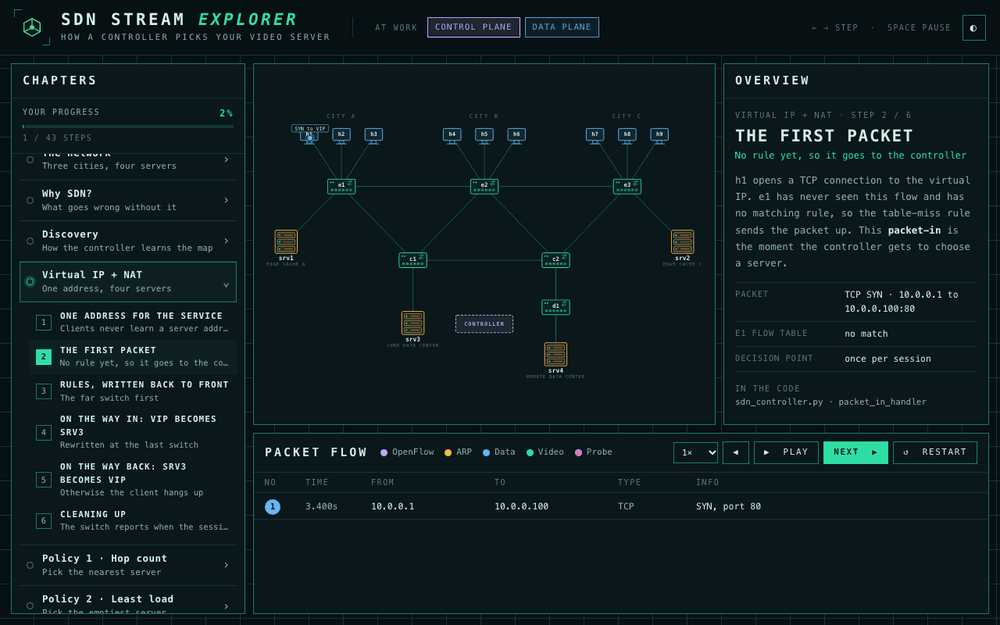
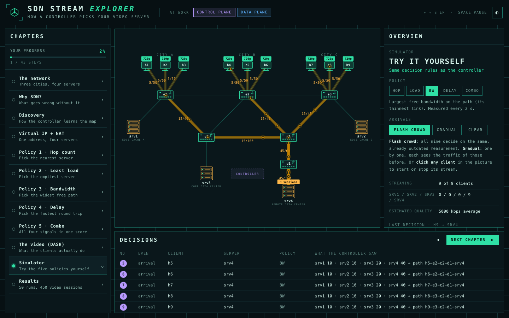
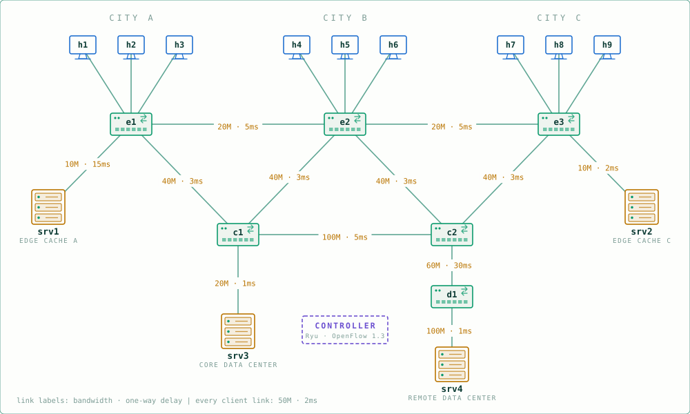
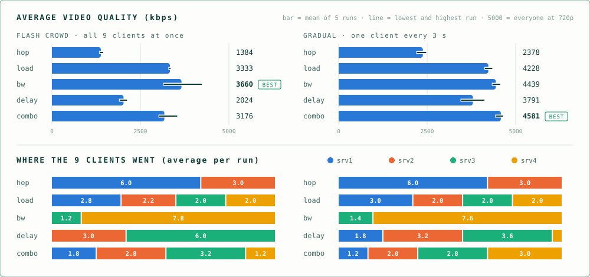

# SDN Video Streaming Load Balancer

**Nine viewers, four video servers, one controller that decides who watches from where.**
I built an SDN controller that hides four servers behind a single virtual IP, tried five different ways of choosing a server for each new viewer, and measured which one actually gives people the best video.



<p align="center">
  <b>Ryu</b> · <b>OpenFlow 1.3</b> · <b>Mininet</b> · <b>Open vSwitch</b> · <b>MPEG-DASH</b> · <b>Python</b>
</p>

---

## The short version

- Clients connect to **one address** (`10.0.0.100`). No machine owns it. The controller picks a real server for every new viewer and the switches rewrite the packets on the fly, in both directions. The client never notices.
- The network has **loops and no spanning tree**. Nothing is ever flooded: the controller discovers the topology itself, answers ARP itself, and installs a loop-free path per connection.
- Server selection is pluggable. I implemented **five policies**: hop count, least load, available bandwidth, measured delay, and a weighted combination of all four.
- Bandwidth and delay are **measured live** from the switches, not read from a config file.
- Real video is streamed: an adaptive (DASH) client downloads real segments and reports quality, startup time and stalls.
- I compared the policies in **50 automated runs (450 video sessions)**. The headline: *the smartest policy wins when it has a few seconds to measure, and loses to a simple counter when everyone arrives at once.*

## See it move: the interactive explorer

I also built a small web app that explains the whole project step by step, with animated packets, a simulator where you can try each policy yourself, and the results as charts. No install, no build step, no internet needed:

```bash
git clone https://github.com/khazenS/sdn-video-streaming.git
open sdn-video-streaming/web/index.html      # Linux: xdg-open · Windows: just double-click the file
```

That is all. It is plain HTML, CSS and JavaScript.



## The network

<picture>
  <source media="(prefers-color-scheme: dark)" srcset="docs/img/topology-dark.svg">
  
</picture>

A small streaming company in three cities. Every server holds the same video, but they are far from equal:

| Server | Where | Link | The catch |
|---|---|---|---|
| `srv1` | edge cache in city A | 10 Mbps, 15 ms | close to city A, but thin and slow |
| `srv2` | edge cache in city C | 10 Mbps, 2 ms | close to city C, but thin |
| `srv3` | data center at the core | 20 Mbps, 1 ms | good at everything, not huge |
| `srv4` | remote data center | 100 Mbps, 1 ms | the fattest pipe, behind a 30 ms link |

The whole topology lives in one file, [`net_config.py`](net_config.py), which both the emulated network and the controller read.

## How it works

**1. The controller learns the map.** It discovers switch-to-switch links with LLDP and learns where each host is from the first packet that host sends.

**2. Nothing is flooded.** In a network with loops, a single broadcast circles forever and takes the network down (I tried it on purpose, it takes seconds). So the controller answers every ARP request itself, and for the virtual IP it answers with a made-up MAC address.

**3. The first packet of a viewer goes to the controller.** The switch has no rule for it yet. The controller picks a server, computes the path, and installs rules on every switch along it, starting from the switch nearest the server so that no packet can outrun its rules.

**4. The last switch does the address translation.** On the way in, the destination is rewritten from the virtual IP to the real server. On the way back, the source is rewritten to the virtual IP again. Without that second half the client would drop the reply, because it never opened a connection to that server.

**5. When the video ends, the rules expire** and the switch tells the controller, which is how the controller keeps count of active viewers per server.

All of this is in one file: [`sdn_controller.py`](sdn_controller.py).

## Five ways to pick a server

| Policy | Picks the server with... | Where the signal comes from | Blind spot |
|---|---|---|---|
| `hop` | the fewest links to the client | the topology map | ignores capacity completely |
| `load` | the fewest active viewers | a counter, updated instantly | a 10 Mbps server counts the same as a 100 Mbps one |
| `bw` | the most free bandwidth on the path | switch port counters, every 2 s | herd effect; ignores distance |
| `delay` | the lowest path delay | probe packets timed by the controller, every 5 s | measurements are old when a crowd arrives |
| `combo` | the best weighted mix of all four | all of the above, normalised to 0..1 | only as fresh as its slowest signal |

You switch between them with one environment variable: `LB_MODE=combo`.

## What I measured

Each run starts a fresh controller and network, launches nine clients that each watch 30 seconds of adaptive video (360p / 540p / 720p), and collects their logs. Two scenarios, five policies, five runs each:

- **Flash crowd**: all nine clients press play at the same instant.
- **Gradual**: one client every three seconds.

<picture>
  <source media="(prefers-color-scheme: dark)" srcset="docs/img/results-dark.svg">
  
</picture>

| | Policy | Quality (kbps) | Startup (s) | Stalls per run | Quality switches per client |
|---|---|---|---|---|---|
| **Flash crowd** | hop | 1384 | 0.90 | 0.4 | 1.3 |
| | load | 3333 | 0.43 | 0.2 | 2.2 |
| | bw | **3660** | 0.47 | **0.0** | 3.9 |
| | delay | 2024 | 0.53 | 1.2 | 3.1 |
| | combo | 3176 | **0.39** | 0.6 | 3.1 |
| **Gradual** | hop | 2378 | 0.66 | 0.4 | 3.3 |
| | load | 4228 | 0.40 | **0.0** | 2.5 |
| | bw | 4439 | 0.44 | **0.0** | 2.6 |
| | delay | 3791 | 0.41 | 0.4 | 2.8 |
| | combo | **4581** | **0.30** | **0.0** | **1.8** |

Quality is the average bitrate a client watched; 5000 kbps would mean everyone at 720p the whole time. All 450 sessions played to the end.

### What the numbers say

- **Hop count is the worst idea, both times.** "Nearest" sent six of nine viewers to the same 10 Mbps cache while two data centers sat idle. It never looks at the network, so it makes the same mistake every single run.
- **Least load is boring and reliable.** Its counter changes the moment a server is assigned, so it cannot be surprised by a crowd. It had the smallest run-to-run variation of all (±17 kbps in the flash crowd).
- **Bandwidth herds.** With measurements up to two seconds old, everybody sees the same "empty" data center and runs to it: 7.8 of 9 clients on `srv4`. That server is big enough to survive it, so quality was high, but results swung by ±491 kbps between runs.
- **Delay had the most stalls in a flash crowd.** All nine clients were judged against measurements of an empty network, and six of them landed on one 20 Mbps link.
- **Combo wins everything when arrivals are spread out**: best quality, fastest startup, calmest picture, zero stalls. In a flash crowd it drops to third, because three quarters of its score comes from signals that are stale or static in that instant.

**My takeaway:** a signal is only as good as it is fresh. Every single metric has a blind spot, combining them covers the blind spots, but only if the controller gets time to measure.

## Things that surprised me

- **Spanning tree makes paths longer.** Before writing the controller I ran the same topology with classic STP. It blocked the direct links to the core, and a 12 ms round trip became 32 ms. That was the moment SDN made sense to me.
- **Measured delay can feel congestion.** While one client was filling its buffer over a 10 Mbps link, my delay probe got stuck in the queue behind the video, and a 2 ms link measured 33 ms. The next client was steered away from that server. A delay value read from a config file could never do that.
- **Delay matters even when bandwidth is plenty.** Each video segment is a new TCP connection, and TCP ramps up slowly over a long round trip. From the far data center a client measured far less speed than the links could carry, and kept switching quality.
- **An idle VM lies about time.** When the VM had nothing to do, emulated link delays came out up to three times too high and jittery. Keeping the CPUs busy with a low-priority loop made a 30 ms round trip measure 30.04 ms. The experiment script does this automatically.

## Run it yourself

You need a Linux machine or VM (I used Ubuntu 22.04) with root access.

**1. Install**

```bash
sudo apt install mininet openvswitch-switch ffmpeg python3-venv

git clone https://github.com/khazenS/sdn-video-streaming.git
cd sdn-video-streaming

# Ryu gets its own environment (it needs an older setuptools)
python3 -m venv ~/ryu-env
~/ryu-env/bin/pip install setuptools==57.5.0 wheel
~/ryu-env/bin/pip install -r requirements.txt
```

**2. Create the test video** (60 seconds, three qualities, about 65 MB)

```bash
bash prepare_video.sh
```

**3. Run the whole comparison** (50 runs, about 40 minutes)

```bash
cd experiments
sudo python3 run_experiment.py --ryu ~/ryu-env/bin/ryu-manager
sudo python3 analyze.py        # sudo only because the results folder was created by root
```

For a quick look, one run of one policy takes under a minute:

```bash
sudo python3 run_experiment.py --ryu ~/ryu-env/bin/ryu-manager --modes combo --scenarios gradual --runs 1 --out quick_test
sudo python3 analyze.py --results quick_test
```

**Or drive it by hand**, which is the best way to see what is going on:

```bash
# terminal 1: the controller
LB_MODE=combo ~/ryu-env/bin/ryu-manager --observe-links sdn_controller.py

# terminal 2: the network (opens the Mininet prompt)
sudo python3 video_topo.py
```

Then, at the `mininet>` prompt, one line at a time:

```
pingall
srv1 python3 -m http.server 80 --directory video > /tmp/srv1.log 2>&1 &
srv2 python3 -m http.server 80 --directory video > /tmp/srv2.log 2>&1 &
srv3 python3 -m http.server 80 --directory video > /tmp/srv3.log 2>&1 &
srv4 python3 -m http.server 80 --directory video > /tmp/srv4.log 2>&1 &
h1 python3 dash_client.py http://10.0.0.100
```

Watch the controller's terminal while the client runs: it prints what it measured, the score of every server, and the one it chose.

## What is in the repository

| File | What it does |
|---|---|
| [`sdn_controller.py`](sdn_controller.py) | The controller: discovery, proxy ARP, routing, virtual IP + NAT, the five policies, bandwidth and delay measurement |
| [`net_config.py`](net_config.py) | The topology in one place: switches, servers, links |
| [`video_topo.py`](video_topo.py) | Builds that topology in Mininet |
| [`dash_client.py`](dash_client.py) | Adaptive video client: downloads real segments, simulates the playback buffer, reports quality |
| [`prepare_video.sh`](prepare_video.sh) | Encodes the test video in three qualities with ffmpeg |
| [`experiments/run_experiment.py`](experiments/run_experiment.py) | Runs every policy in both scenarios, unattended |
| [`experiments/analyze.py`](experiments/analyze.py) | Turns the raw logs into the result tables |
| [`experiments/results/`](experiments/results) | The results of my 50 runs: summary tables and one row per client |
| [`web/`](web) | The interactive explorer |

## What I would do next

- **Reserve bandwidth at assignment time.** Subtract a stream's worth of capacity the moment a server is chosen instead of waiting for the next measurement. That should cure the herd effect.
- **Smooth the measurements.** A single delay sample on a 1 ms link is mostly noise. Averaging the last few rounds would stop borderline clients from flipping between servers.
- **Choose the path, not just the server.** Paths are still the shortest by hop count, even in bandwidth and delay mode. A widest-path or lowest-delay route is the natural next step.
- **Re-select per segment.** Every DASH segment is a new TCP connection, so a viewer could be moved to a better server mid-video without breaking anything, as long as there is some hysteresis to stop ping-pong.

## Want the details?

How the delay probe removes the control channel from its own measurement, the exact OpenFlow rules, the scoring formula with a worked example, and the experiment method are all in the **[technical deep dive](docs/TECHNICAL.md)**.
